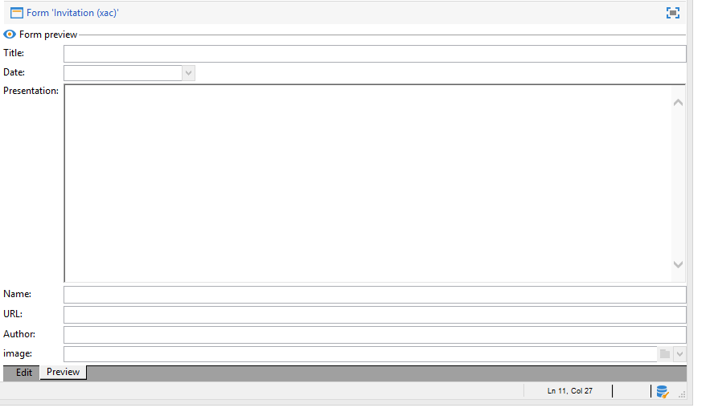
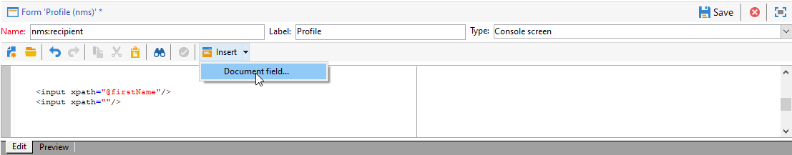

# Edit forms{#editing-forms}

## Overview

Marketers and operators use input forms to create, modify, and preview records. Forms show a visual representation of information.

>[!NOTE]
>
>As part of the transition from Campaign v7 to v8, the Campaign Classic documentation set has been streamlined and reorganized. Common features are now available exclusively in the Campaign v8 documentation set. To learn more about input forms, refer to the [Campaign v8 documentation](https://experienceleague.adobe.com/en/docs/campaign/campaign-v8/developer/schemas-forms/forms){target=_blank}.
>
>[](https://experienceleague.adobe.com/en/docs/campaign/campaign-v8/developer/schemas-forms/forms){target="_blank"}

You can create and modify input forms:

* You can modify the factory input forms that are delivered by default. The factory input forms are based on the factory data schemas.
* You can create custom input forms, based on data schemas that you define.

Forms are entities of `xtk:form` type. You can view the input form structure in the `xtk:form` schema. To view this schema, choose **[!UICONTROL Administration]** > **[!UICONTROL Configuration]** > **[!UICONTROL Data schemas]** from the menu. Read more about [form structure](https://experienceleague.adobe.com/en/docs/campaign/campaign-v8/developer/schemas-forms/forms){target="_blank"} (Campaign v8 documentation).

To access input forms, choose **[!UICONTROL Administration] > [!UICONTROL Configuration] > [!UICONTROL Input forms]** from the menu:


To design forms, edit the XML content in the XML editor:


[Read more](https://experienceleague.adobe.com/en/docs/campaign/campaign-v8/developer/schemas-forms/forms#formatting){target="_blank"} (Campaign v8 documentation).

To preview a form, click the **[!UICONTROL Preview]** tab:


## Form types

You can create different types of input forms. The form type determines how users navigate the form:

* Console screen 

  This is the default form type. The form comprises a single page.

  

* Content Management

  Use this form type for content management. See this [use case](../../delivery/using/use-case-creating-content-management.md).

  

* Assistant

  This form comprises multiple floating screens that are ordered in a specific sequences. Users navigate from one screen to the next. [Read more](https://experienceleague.adobe.com/en/docs/campaign/campaign-v8/developer/schemas-forms/forms#wizards){target="_blank"} (Campaign v8 documentation).

* Iconbox

  This form comprises multiple pages. To navigate the form, users select icons at the left of the form.

  

* Notebook

  This form comprises multiple pages. To navigate the form, users select tabs at the top of the form.

  

* Vertical pane

  This form shows a navigation tree.

* Horizontal pane

  This form shows a list of items.

## References to images

To find images, choose **[!UICONTROL Administration]** > **[!UICONTROL Configuration]** > **[!UICONTROL Images]** from the menu.

To associate an image with an element in the form, for example, an icon, you can add a reference to an image. Use the `img` attribute, for example, in the `<container>` element.

Syntax: `img="`*`namespace`*`:`*`filename`*`.`*`extension`*`"`

This example shows references to the `book.png` and `detail.png` images from the `ncm` namespace:

```xml
<container img="ncm:book.png" label="General">
[…]
</container>
<container img="ncm:detail.png" label="Details">
[…]
</container>
```

These images are used for icons that users click to navigate a multipage form:


## Create a simple form {#create-simple-form}

To create a form, follow these steps:

1. From the menu, choose **[!UICONTROL Administration]** > **[!UICONTROL Configuration]** > **[!UICONTROL Input forms]**.
1. Click the **[!UICONTROL New]** button at the top right of the list.

    

1. Specify the form properties:

   * Specify the form name and the namespace.
      
      The form name and the namespace can match the related data schema.  This example shows a form for the `cus:order` data schema:

      ```xml
      <form entitySchema="xtk:form" img="xtk:form.png" label="Order" name="order" namespace="cus" type="iconbox" xtkschema="xtk:form">
        […]
      </form>
      ```

     Alternatively, you can explicitly specify the data schema in the `entity-schema` attribute.
    
     ```xml
     <form entity-schema="cus:stockLine" entitySchema="xtk:form" img="xtk:form.png" label="Stock order" name="stockOrder" namespace="cus" xtkschema="xtk:form">
       […]
     </form>
     ```

   * Specify the label to be displayed on the form.
   * Optionally, specify the form type. If you do not specify a form type, the console screen type is used by default.

      

       If you are designing a multipage form, you can omit the form type in the `<form>` element and specify the type in a container.

1. Click **[!UICONTROL Save]**.

1. Insert the form elements.
   
   For example, to insert an input field, use the `<input>` element. Set the `xpath` attribute to the field reference as an XPath expression. [Read more](https://experienceleague.adobe.com/en/docs/campaign/campaign-v8/developer/schemas-forms/schema-structure#reference-with-xpath){target="_blank"} (Campaign v8 documentation).

   This example shows input fields based on the `nms:recipient` schema.

   ```xml
   <input xpath="@firstName"/>
   <input xpath="@lastName"/>
   ```

1. If the form is based on a specific schema type, you can look up the fields for this schema:

   1. Click **[!UICONTROL Insert]** > **[!UICONTROL Document fields]**.

      

   1. Select the field and click **[!UICONTROL OK]**.
    
      

1. Optionally, specify the field editor.

   A default field editor is associated with each data type:
   * For a date-type field, the form shows an input calendar.
   * For an enumeration-type field, the form shows a selection list.

   You can use these field editor types:
  
   | Field editor | Form attribute |
   | --- | --- |
   | Radio button | `type="radiobutton"` |
   | Checkbox | `type="checkbox"` |
   | Edit tree | `type="tree"` |

    Read more about [memory list controls](https://experienceleague.adobe.com/en/docs/campaign/campaign-v8/developer/schemas-forms/forms#memory-list-controls){target="_blank"} (Campaign v8 documentation).

1. Optionally, define access to the fields:

   | Element | Attribute | Description |
   | --- | --- | --- |
   | `<input>` | `read-only="true"` | Provides read-only access to a field |
   | `<container>` | `type="visibleGroup" visibleIf="`*edit-expr*`"` | Conditionally displays a group of fields |
   | `<container>` | `type="enabledGroup" enabledIf="`*edit-expr*`"` | Conditionally enables a group of fields |

   Example:
   
   ```xml
   <container type="enabledGroup" enabledIf="@gender=1">
     […]
   </container>
   <container type="enabledGroup" enabledIf="@gender=2">
     […]
   </container>
   ```

1. Optionally, use containers to group fields into sections.

   ```xml
   <container type="frame" label="Name">
      <input xpath="@firstName"/>
      <input xpath="@lastName"/>
   </container>
   <container type="frame" label="Contact details">
      <input xpath="@email"/>
      <input xpath="@phone"/>
   </container>
   ```

   

## Create a multipage form {#create-multipage-form}

You can create multipage forms. You can also nest forms within other forms. Read more about [containers, notebook and iconbox forms](https://experienceleague.adobe.com/en/docs/campaign/campaign-v8/developer/schemas-forms/forms#containers){target="_blank"} (Campaign v8 documentation).

## Modify a factory input form {#modify-factory-form}

To modify a factory form, follow these steps:

1. Modify the factory input form:

   1. From the menu, choose **[!UICONTROL Administration]** > **[!UICONTROL Configuration]** > **[!UICONTROL Input forms]**.
   1. Select an input form and modify it.

    You can extend factory data schemas, but you cannot extend factory input forms. We recommend that you modify factory input forms directly without recreating them. During software upgrades, your modifications in the factory input forms are merged with the upgrades. If the automatic merge fails, you can resolve the conflicts. [Read more](../../production/using/upgrading.md#resolving-conflicts).

    For example, if you extend a factory schema with an additional field, you can add this field to the related factory form.

## Validate forms {#validate-forms}

You can include validation controls in forms.

### Check mandatory fields 

You can check mandatory information:

* Use the `required="true"` attribute for the required fields.
* Use the `<leave>` node to check these fields and show error messages.

In this example, the email address is required, and an error message is displayed if the user has not provided this information:

```xml
<input xpath="@email" required="true"/>
<leave>
  <check expr="@email!=''">
    <error>The email address is required.</error>
  </check>
</leave>
```

Read more about [expression fields](https://experienceleague.adobe.com/en/docs/campaign/campaign-v8/developer/schemas-forms/forms#expression-field){target="_blank"} (Campaign v8 documentation) and [form context](https://experienceleague.adobe.com/en/docs/campaign/campaign-v8/developer/schemas-forms/forms#context-of-forms){target="_blank"} (Campaign v8 documentation).

### Validate values

You can use JavaScript SOAP calls to validate form data from the Console. Use these calls for complex validation, for example, to check a value against a list of authorized values. [Read more](https://experienceleague.adobe.com/en/docs/campaign/campaign-v8/developer/schemas-forms/forms#soap-methods){target="_blank"} (Campaign v8 documentation).

1. Create a validation function in a JS file.

   Example:

    ```js
    function nms_recipient_checkValue(value)
    {
      logInfo("checking value " + value)
      if (…)
      {
        logError("Value " + value + " is not valid")
      }
      return 1
    }
    ```

    In this example, the function is named `checkValue`. This function is used to check the `recipient` data type in the `nms` namespace. The value that is being checked is logged. If the value is not valid, then an error message is logged. If the value is valid, then the value 1 is returned.

    You can use the returned value to modify the form.

1. In the form, add the `<soapCall>` element to the `<leave>` element.

    In this example, a SOAP call is used to validate the `@valueToCheck` string:

    ```xml
    <form name="recipient" (…)>
    (…)
      <leave>
        <soapCall name="checkValue" service="nms:recipient">
          <param exprIn="@valueToCheck" type="string"/>
        </soapCall>
      </leave>
    </form>
    ```

   In this example, the `checkValue` method and the `nms:recipient` service are used:

   * The service is the namespace and the data type.
   * The method is the function name. The name is case-sensitive.
      
    The call is performed synchronously.

    All exceptions are displayed. If you use the `<leave>` element, then users cannot save the form until the entered information is validated.

This example shows how you can make service calls from within forms:

```xml
<enter>
  <soapCall name="client" service="c4:ybClient">
    <param exprIn="@id" type="string"/>
    <param type="boolean" xpathOut="/tmp/@count"/>
  </soapCall>
</enter>
```

In this example, the input is an ID, which is a primary key. When users fill the form for this ID, a SOAP call is made with this ID as the input parameter. The output is a boolean that is written to this field: `/tmp/@count`. You can use this boolean inside the form. Read more about [form context](https://experienceleague.adobe.com/en/docs/campaign/campaign-v8/developer/schemas-forms/forms#context-of-forms){target="_blank"} (Campaign v8 documentation).
