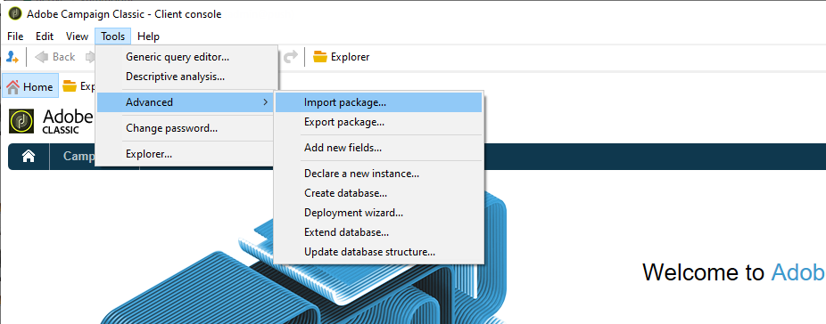
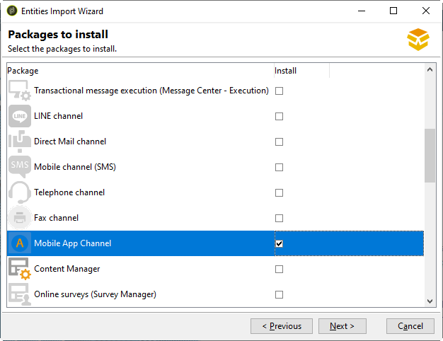
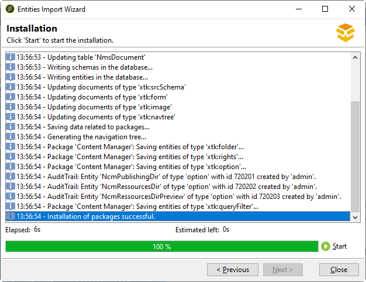

# Get started with mobile app channel{#about-mobile-app-channel}

With Adobe Campaign, create push notification deliveries to send personalized messages to your mobile app users.

>[!NOTE]
>
>As part of the transition from Campaign v7 to v8, the Campaign Classic documentation set has been streamlined and reorganized. Common features are now available exclusively in the Campaign v8 documentation set. To learn more about the push notification channel, refer to the [Campaign v8 documentation](https://experienceleague.adobe.com/en/docs/campaign/campaign-v8/send/push/push){target=_blank}.
>
>{target=_blank}

The following information is specific to Campaign Classic.

+++ **Package installation**

 [Learn how to install the mobile app package in video](https://experienceleague.adobe.com/docs/campaign-classic-learn/tutorials/sending-messages/push-channel/installing-the-mobile-app-channel.html#sending-messages)

As a hybrid/hosted customer, contact [Adobe Customer Care](https://helpx.adobe.com/enterprise/admin-guide.html/enterprise/using/support-for-experience-cloud.ug.html) team to access push notification channel in Campaign. 

As an on-premise customer, you need to install a built-in package.

>[!CAUTION]
>
>Learn more about Campaign built-in packages, best practices and recommendations in [this page](../../installation/using/installing-campaign-standard-packages.md).

Installation steps are:

1. Access the package import assistant from **[!UICONTROL Tools > Advanced > Import package]** in the Adobe Campaign client console.

   

1. Select **[!UICONTROL Install a standard package]**.

1. In the list that appears, check **[!UICONTROL Mobile App Channel]**.

   

1. Click **[!UICONTROL Next]**, then **[!UICONTROL Start]** to start the package installation.

   Once the packages are installed, the progress bar shows **100%** and you can see the following message in the installation logs: **[!UICONTROL Installation of packages successful]**.

   

1. **[!UICONTROL Close]** the installation window.

Once this step is done, you can configure your Android and iOS apps. Refer to the Campaign v8 [documentation](https://experienceleague.adobe.com/docs/campaign/campaign-v8/send/push/push.html){target="_blank"}.

+++

+++ **Troubleshooting**

If your mobile device is connected to Wi-Fi and you are not receiving notifications, check that the FCM/APNs ports are not being blocked by your firewall.

**Android**: The mobile device connects to the FCM servers on ports 5228 to 5230. You therefore must configure your firewall so that it authorizes connection with FCM. The ports to open are: 5228 (the most frequently used), 5229 and 5230.

**iOS**:

HTTP/2 connector: you must allow communication to and from the following servers:

* api.push.apple.com: port 443
* api.development.push.apple.com: port 443

>[!NOTE]
>
>For more information on the two connectors, refer to the Campaign v8 [documentation](https://experienceleague.adobe.com/docs/campaign/campaign-v8/send/push/push-settings.html){target="_blank"}.

+++
