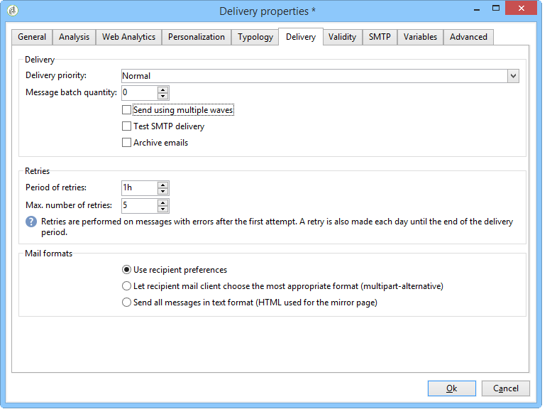

# Configure and send the delivery {#configuring-and-sending-the-delivery}

This page describes the delivery sending settings that are specific to on-premise and hybrid installations of Campaign Classic v7.

As part of the transition from Campaign v7 to v8, the Campaign Classic documentation set has been streamlined and reorganized. Common features are now available exclusively in the Campaign v8 documentation set. To learn more about delivery sending settings, refer to the [Campaign v8 documentation](https://experienceleague.adobe.com/en/docs/campaign/campaign-v8/send/validate/configure-and-send){target=_blank}.

{target=_blank}

## Delivery additional parameters {#delivery-additiona-parameters}

Before sending the delivery, you can define the sending parameters in the delivery properties, via the **[!UICONTROL Delivery]** tab.

* **[!UICONTROL Test SMTP delivery]**: use this option to test sending via SMTP. The delivery is processed up to connection to the SMTP server but is not sent: for every recipient of the delivery, Campaign connects to the SMTP provider server, executes the SMTP RCPT TO command, and closes the connection before the SMTP DATA command.

  >[!NOTE]
  >
  >* This option must not be set in mid-sourcing. 
  >
  >* Learn more about SMTP server configuration, in [this section](../../installation/using/configure-delivery-settings.md).

## Configure retries {#configuring-retries}

>[!IMPORTANT]
>
>For hosted or hybrid installations, if you have upgraded to the [Enhanced MTA](sending-with-enhanced-mta.md), the retry settings in the delivery are no longer used by Campaign. Soft bounce retries and the length of time between them are determined by the Enhanced MTA based on the type and severity of the bounce responses coming back from the message's email domain.

For on-premise installations and hosted/hybrid installations using the legacy Campaign MTA, the central section of the **[!UICONTROL Delivery]** tab for delivery parameters indicates how many retries should be performed the day after the delivery and the minimum delay between retries.

By default, five retries are scheduled for the first day of the delivery with a minimum interval of one hour spread out over the 24 hours of the day. One retry per day is programmed after that and until the delivery deadline, which is defined in the **[!UICONTROL Validity]** tab. See [Define the validity period](#defining-validity-period).

## Define the validity period {#defining-validity-period}

When the delivery has been launched, the messages (and any retries) can be sent until the delivery deadline. This is indicated in the delivery properties, via the **[!UICONTROL Validity]** tab.

* The **[!UICONTROL Delivery duration]** field lets you enter the limit for global delivery retries. This means that Adobe Campaign sends the messages beginning on the start date, and then, for messages returning an error only, regular, configurable retries are performed until the validity limit is reached.

  >[!IMPORTANT]
  >
  >For hosted or hybrid installations, if you have upgraded to the [Enhanced MTA](sending-with-enhanced-mta.md), the **[!UICONTROL Delivery duration]** setting in your Campaign email deliveries will be used only if set to **3.5 days or less**. If you define a value higher than 3.5 days, it will not be taken into account.

* **Validity limit of resources**: The **[!UICONTROL Validity limit]** field is used for uploaded resources, mainly for the mirror page and images. The resources on this page are valid for a limited time (to save disk space).

  The values in this field can be expressed in the following units: **s** for seconds, **m** for minutes, **h** for hours, **d** for days (default), **y** for years.
