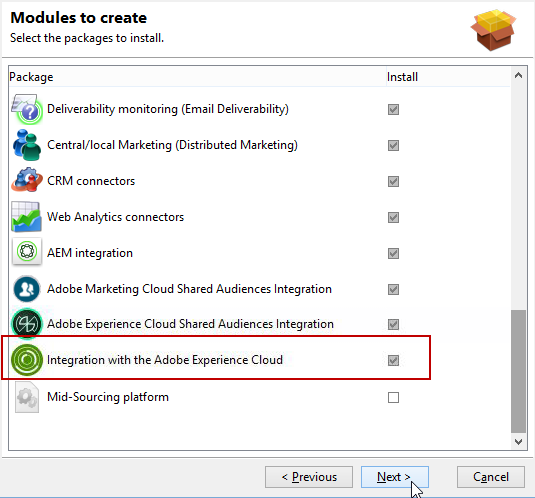
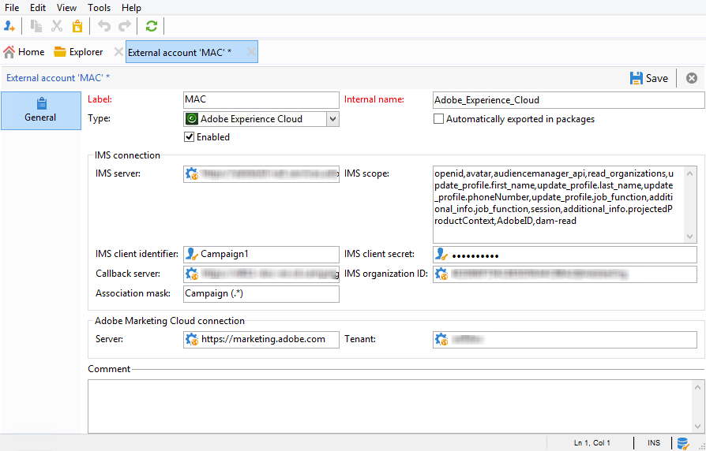

# Configuring IMS{#configuring-ims}

>[!IMPORTANT]
>
>As a Campaign hosted or managed services user, your Adobe IMS implementation is owned by Adobe. Steps decribed below only apply to on-premise and hybrid customers.
> Adobe IMS implementation must only be performed by Adobe technical administrators. Contact your Adobe representative to start the implementation process.

## Prerequisites {#prerequisites}

* You must have an Adobe Experience Cloud Organization name and ID. To find your Organization ID, refer to [this page](https://experienceleague.adobe.com/docs/core-services/interface/administration/organizations.html){_blank}.
* You have to add users in the Experience Cloud. For more on this, refer to [this page](https://experienceleague.adobe.com/docs/core-services/interface/administration/admin-getting-started.html){_blank}.

>[!NOTE]
>
>Make sure that your users are linked to the Adobe Experience Cloud groups that will be synced with Adobe Campaign. [Learn more](#configuring-the-external-account).

## Updating the console {#updating-the-console}

To use this functionality, it is imperative that you install the latest version of the Client console.

## Installing the package {#installing-the-package}

You must install the built-in **[!UICONTROL Integration with the Adobe Experience Cloud]** package. Installing an integration package is the same as installing a standard package, which is detailed in [this page](../../installation/using/installing-campaign-standard-packages.md). 

## Configuring the external account {#configuring-the-external-account}

Configure the **Adobe Experience Cloud** external account in **[!UICONTROL Administration > Platform > External accounts]**.

Enter the following information:

* Connection information for the IMS server used (ID and secret). This information is provided by Adobe Customer Care team. For more information, refer to the [FAQ for Adobe Experience Cloud Administrators](https://experienceleague.adobe.com/docs/core-services/interface/manage-users-and-products/faq.html).

  The **[!UICONTROL Callback server]** address must be specified in **https**. This field corresponds to the access URL of your Adobe Campaign instance.

* Organization ID: to find your organization ID, refer to [this page](https://experienceleague.adobe.com/docs/core-services/interface/administration/organizations.html){_blank}.

* Association mask: this field allows you to define the syntax which will allow configuration names in Enterprise Dashboard to be synced with the groups in Adobe Campaign. If you use the syntax "Campaign - tenant_id - (.&#42;)", the security group created in Adobe Campaign will be linked to the configuration name "Campaign - tenant_id - internal_name" in Enterprise Dashboard.

* Adobe Experience Cloud connection information, which is the name of the Adobe Experience Cloud Tenant.
