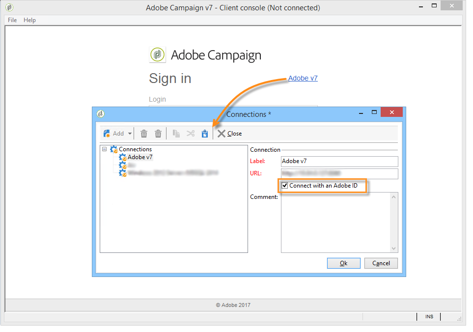

# Implementing IMS{#implementing-ims}

Once [IMS configuration](configuring-ims.md) is done, you can enable the connection.

To enable the IMS authentication mode in Adobe Campaign, follow these steps:

1. Open the Client Console connection screen.
1. Select the environment you need to enable the connection for.
1. Check the **[!UICONTROL Connect with an Adobe ID]** option and save your changes.

   

1. When connecting to this environment, use your Adobe ID and password.
