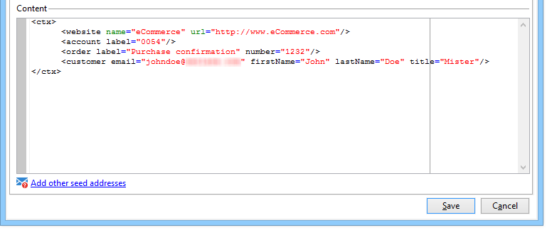

# Test transactional message templates {#testing-message-templates}

Once your [message template](https://experienceleague.adobe.com/en/docs/campaign/campaign-v8/send/real-time/transactional-template){target="_blank"} (Campaign v8 documentation) is ready, follow the steps below to preview and test it.

As part of the transition from Campaign v7 to v8, the Campaign Classic documentation set has been streamlined and reorganized. Common features are now available exclusively in the Campaign v8 documentation set. To learn how to add seed addresses, preview a transactional message and send a proof, refer to the [Campaign v8 documentation](https://experienceleague.adobe.com/en/docs/campaign/campaign-v8/send/real-time/transactional-template#test-message-template){target=_blank}.

{target=_blank}

## Personalization data {#personalization-data}

It is possible to use data in the message template to test transactional message personalization. This functionality is used to generate a preview or send a proof. You can also display the rendering of the message for various internet access providers. For more on this, see [Inbox rendering](../../delivery/using/inbox-rendering.md).

The purpose of this data is to test your messages before their final delivery. These messages do not coincide with actual data to be processed. However, the XML structure must be identical to that of the event stored in the execution instance, as shown below:

This information enables you to personalize message content using personalization tags (for more on this, see [Create the message content](https://experienceleague.adobe.com/en/docs/campaign/campaign-v8/send/real-time/transactional-template#create-message-content){target="_blank"} (Campaign v8 documentation)).

1. Select the transactional message template.

1. In the template, click the **[!UICONTROL Seed addresses]** tab.

1. In the event content, enter the test information in XML format.

   

1. Click **[!UICONTROL Save]**.
