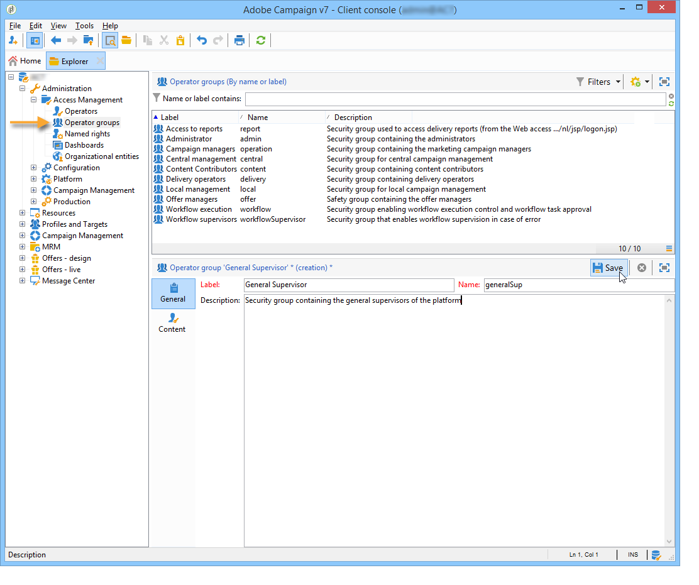
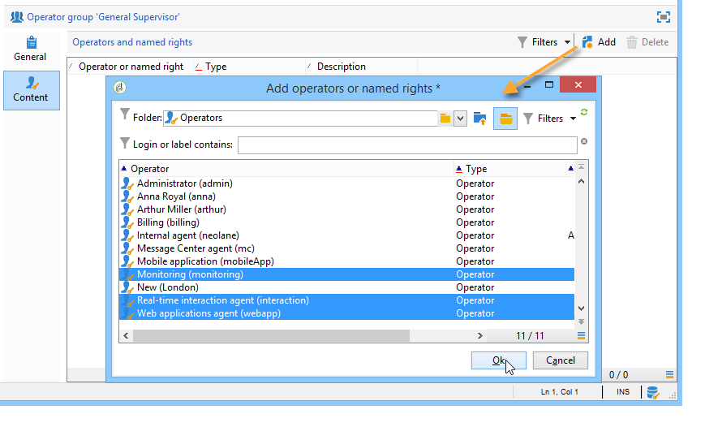

# Create and manage operator groups {#operator-groups}

>[!NOTE]
>
>These procedures only apply for operators connecting to Campaign with the **legacy native authentication**. Starting Campaign Classic v7.3.1, all operators should use [Adobe Identity Management System (IMS)](https://helpx.adobe.com/enterprise/using/identity.html){target="_blank"} to connect to Campaign. [Learn more](../../technotes/using/migrate-users-to-ims.md)
>
>When connecting to Campaign with your Adobe ID, the following section no longer applies. Learn how to set up permissions with Adobe IMS in [Campaign v8 documentation](https://experienceleague.adobe.com/docs/campaign/campaign-v8/admin/permissions/gs-permissions.html){target="_blank"}. 

Operator groups are created via the **[!UICONTROL Administration > Access management > Operator groups]** node in the tree.

As part of the transition from Campaign v7 to v8, the Campaign Classic documentation set has been streamlined and reorganized. Common features are now available exclusively in the Campaign v8 documentation set. To learn more about default operator groups and their named rights, refer to the [Campaign v8 documentation](https://experienceleague.adobe.com/en/docs/campaign/campaign-v8/permissions/manage-permissions#ootb-productprofiles){target=_blank}.

{target=_blank}

## Create a new operator group {#creating-a-new-operator-group}

To create a new operator group, apply the following steps:

1. Click the **[!UICONTROL New]** button to the right of the list of groups or right-click the list and choose **[!UICONTROL New]**.
1. In the section lower window, from the **[!UICONTROL General]** tab, enter the name and a description for this group in the corresponding fields.

   

1. Click the **[!UICONTROL Content]** tab to define authorizations for this group.
1. Click the **[!UICONTROL Add]** button to select an appointed right or an operator to associate to the group.
1. Click the drop-down list or on the folder to the right of the **[!UICONTROL Folder]** field to locate the appointed rights or operators to associate to this group.
1. Select the rights or operators to add and click **[!UICONTROL OK]** to validate.

   

   Repeat this operation to add other rights or operators.

1. Click the **[!UICONTROL Save]** button to add the group to the list.
