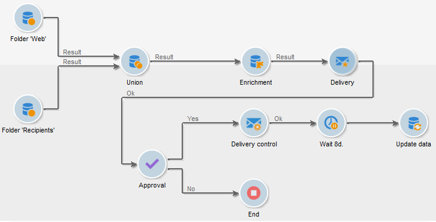

# Automate with workflows {#gs-workflows}

Adobe Campaign's workflows enable your team to streamline and automate end-to-end business processes across the platform. With an intuitive graphical interface, you can design and manage workflows that coordinate tasks such as data segmentation, campaign execution, file handling, and even user approvals — all in one place.

For instance, you can automate a process to retrieve a file from a remote server, extract its contents, and seamlessly load the data into Adobe Campaign server - reducing manual effort and increasing operational efficiency. The workflow engine ensures every step is executed reliably and tracked for visibility and control.

>[!BEGINTABS]

>[!TAB Workflow documentation] 

To learn more about workflows management, refer to the [Campaign v8 documentation](https://experienceleague.adobe.com/docs/campaign/automation/workflows/introduction/about-workflows.html){target=_blank}.

{target=_blank}

>[!TAB Useful links]

Learn the key steps related to workflow management in Campaign v8 documentation:

* [Workflow activities](https://experienceleague.adobe.com/docs/campaign/automation/workflows/wf-activities/activities.html){target=_blank}: An activity is a task template. Workflows include targeting, flow control, action and event activities. 

* [Build a workflow](https://experienceleague.adobe.com/docs/campaign/automation/workflows/introduction/build-a-workflow.html){target=_blank}: Learn how to create and run targeting, campaign and technical workflows. 

* [Best practices](https://experienceleague.adobe.com/docs/campaign/automation/workflows/introduction/workflow-best-practices.html){target=_blank}: Learn guidelines to optimize Campaign workflows performance, improve your workflows design and define the correct settings.

* [Monitor workflows](https://experienceleague.adobe.com/docs/campaign/automation/workflows/monitoring-workflows/monitor-workflow-execution.html){target=_blank}: Learn how to monitor workflow execution to ensure that everything is running correctly.

* [Workflow use cases](https://experienceleague.adobe.com/docs/campaign/automation/workflows/use-cases/workflow-use-cases.html){target=_blank}: Learn contexts in which workflows can be used and how to implement them through end-to-end use cases.

>[!ENDTABS]

<!--

Adobe Campaign uses workflows to:

* Carry out targeting campaigns. [Learn more](https://experienceleague.adobe.com/en/docs/campaign/automation/workflows/introduction/build-a-workflow){target="_blank"} (Campaign v8 documentation)
* Build campaigns: for each campaign, the **[!UICONTROL Workflow]** tab lets you build the target and create the deliveries. [Learn more](https://experienceleague.adobe.com/en/docs/campaign/automation/workflows/introduction/build-a-workflow){target="_blank"} (Campaign v8 documentation)
* Perform technical processes: cleanup, collecting tracking information or provisional calculations. [Learn more](https://experienceleague.adobe.com/en/docs/campaign/automation/workflows/introduction/build-a-workflow){target="_blank"} (Campaign v8 documentation)

A workflow can mean both a process definition (the workflow model, which is a representation of what is supposed to happen) and an instance of this process (a workflow instance, which is a representation of what is actually happening).

The workflow template describes the various tasks to be performed and how they are linked together. The task templates are called activities and are represented by icons. They are linked together by transitions.

Each workflow contains:

* **[!UICONTROL Activities]**

  An activity describes a task template. The various activities available are represented on the diagram by icons. Each type has common properties and specific properties. For example, while all activities have a name and label, only the **[!UICONTROL Approval]** activity has an assignment.

  In a workflow diagram, a given activity can produce multiple tasks, in particular when there is a loop or recurrent (periodic) actions.

  All workflow activities are listed in [this section](https://experienceleague.adobe.com/en/docs/campaign/automation/workflows/wf-activities/activities){target="_blank"} (Campaign v8 documentation), including use cases and samples.

* **[!UICONTROL Transitions]**

  Transitions enable you to link activities and to define their sequence. A transition links a source activity to a destination activity. There are several sorts of transitions, which depend on the source activity. Some transitions have additional parameters such as a duration, a condition or a filter.

  A transition which is not linked to a destination activity is colored orange and the arrow head is shown as a diamond.

  >[!NOTE]
  >
  >A workflow containing unterminated transitions can still be executed: a warning message will be generated and the workflow will pause once it reaches the transition but it will not generate an error. It is thus possible to start a workflow without it being finished and to add to it as you go along.

  For more information about how to build a workflow, refer to [this section](https://experienceleague.adobe.com/en/docs/campaign/automation/workflows/introduction/build-a-workflow){target="_blank"} (Campaign v8 documentation).

* **[!UICONTROL Worktables]**

  The worktable contains all the information carried by the transition. Each workflow uses several worktables. The data conveyed in these tables can be accelerated and used throughout the workflow's life cycle, as long as it is not purged. Indeed, unneeded tables are purged each time the workflow is passivated, and possibly during the execution of the largest workflows to avoid overloading the server.

  Learn more on workflow data and tables in [this section](https://experienceleague.adobe.com/en/docs/campaign/automation/workflows/introduction/use-workflow-data){target="_blank"} (Campaign v8 documentation).

## Key principles and best practices{#principles-workflows}

Refer to these sections to find guidance and best practices to automate processes with workflows:

* Learn more about workflow activities in [this page](https://experienceleague.adobe.com/en/docs/campaign/automation/workflows/introduction/use-workflow-data){target="_blank"} (Campaign v8 documentation).
* Learn how to build a workflow in [this section](https://experienceleague.adobe.com/en/docs/campaign/automation/workflows/introduction/build-a-workflow){target="_blank"} (Campaign v8 documentation).
* Discover how to use workflows to import data in Campaign in [this section](https://experienceleague.adobe.com/en/docs/campaign/campaign-v8/audience/add-profiles/import-profiles){target="_blank"} (Campaign v8 documentation).
* Workflow best practices are detailed in [this page](https://experienceleague.adobe.com/en/docs/campaign/automation/workflows/introduction/workflow-best-practices){target="_blank"} (Campaign v8 documentation).
* Find guidance about workflow execution in [this section](https://experienceleague.adobe.com/en/docs/campaign/automation/workflows/executing-a-workflow/start-a-workflow){target="_blank"} (Campaign v8 documentation).
* Learn how to monitor workflows in [this page](https://experienceleague.adobe.com/en/docs/campaign/automation/workflows/monitoring-workflows/monitor-workflow-execution){target="_blank"} (Campaign v8 documentation).
* Learn how to grant access to users to use workflows in [this page](https://experienceleague.adobe.com/en/docs/campaign/automation/workflows/advanced-management/managing-rights){target="_blank"} (Campaign v8 documentation).

-->