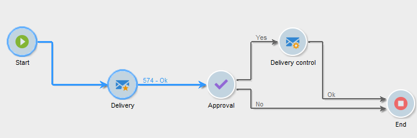

# Workflow life cycle {#workflow-life-cycle}

The workflow cycle has three main steps.

* **Being edited**

  This is the initial design phase: When is new workflow is created, its status is 'Being edited'. The workflow is not yet handled by the server and can be modified without risk.

* **Started**

  Once the initial design phase is complete, the workflow can be started. In this phase, the instance is handled by the server and the individual tasks are executed. The workflow can still be modified with certain precautions.

* **Finished**

  A workflow is 'Finished' when there are no longer any tasks in progress or when an operator has explicitly stopped the instance.

For example, the **Start** and **Delivery** activities are outlined while the **Approval** activity flashes in the workflow below.

This means that the first two activities have been successfully executed and that approval is in progress, i.e. it has been created but not yet completed.

The characters **574 -Ok** displayed above the transition following the **Delivery** activity mean that the delivery preparation has targeted 574 recipients and that the operation was completed successfully. This information, which is added to the transitions when they are executed, is computed by the activities that process data.

The workflow is started and is waiting for an operator belonging to the group specified in the **Approval** activity to make a decision. The operators belonging to the group and who have an email address or mobile telephone number are notified.

Operator management is detailed in this [section](../../platform/using/access-management.md).

For more on how to monitor you workflows, refer to [this section](monitoring-workflow-execution.md).
